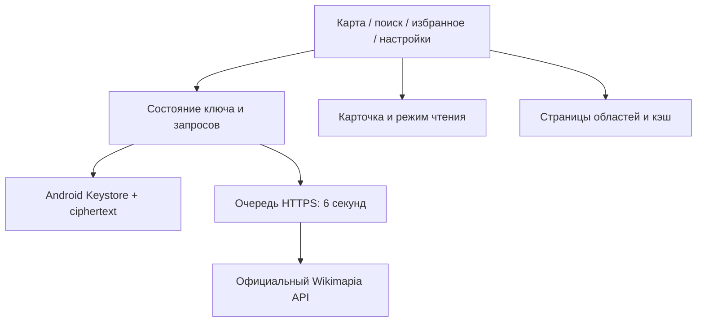

# WikiReader Next — Wikimapia для телефона

Неофициальный Android-клиент для чтения объектов Wikimapia без собственного сервера.
Новая тестовая сборка называется **WikiReader Next** и устанавливается рядом с 0.4.

## Версия 0.13.2

- **Ошибки и предупреждения на карте:** небольшая плашка появляется сверху слева, ниже служебных элементов Яндекс Карт и вне панели управления; в том числе сообщение о недоступной геолокации. Обычные сообщения загрузки остаются снизу.
- [Описание выпуска 0.13.2](docs/releases/0.13.2/RELEASE_NOTES.md).

## Версия 0.13.1

- **GPS Follow:** уведомление о неточном сигнале больше не закрывает карту постоянно, автоматически исчезает через 5 секунд; сообщения компактно размещаются ближе к краю карты.
- **Загрузка при GPS Follow:** перемещение карты больше не ставит загрузчик областей на паузу. Доступность самого Wikimapia API зависит от сети и действующих ограничений ключа; исправление интерфейса не устраняет сетевые тайм-ауты и ошибку API `1004`.
- **Настройки:** версия приложения теперь отображается из единого файла метаданных, без устаревшего номера.
- [Описание выпуска 0.13.1](docs/releases/0.13.1/RELEASE_NOTES.md).

## Версия 0.13.0

- **Рядом со мной:** сортировка уже полученных объектов по приблизительному расстоянию до центра контура после явного запроса GPS. Карта центрируется однократно; непрерывное слежение включается отдельно.
- **Объекты в области:** поиск по названию/ID, фильтры избранного и сохранённого офлайн, сортировка по названию/площади/расстоянию; действия «Показать контур» и «Открыть».
- **Карточка:** «На карте» для загруженной геометрии и «Поделиться» ссылкой на оригинальный объект; Android использует системный выбор приложения.
- **Резервные копии:** экспорт и объединяющий импорт JSON через системный выбор файла на Android. Переносятся избранное, история и тексты/комментарии сохранённых офлайн-карточек; медиа, ключи и координаты не включаются.
- [Описание выпуска 0.13.0](docs/releases/0.13.0/RELEASE_NOTES.md).

## Версия 0.12.0

- **История чтения:** до 50 последних успешно открытых объектов Wikimapia; без геолокации, ключей и полных ответов API. Демо и ошибочные запросы не записываются.
- **Библиотека:** один поиск по названиям избранного и истории, а также по полному тексту выбранных офлайн-карточек. Поиск локальный, без запросов к Wikimapia.
- Историю можно очистить с подтверждением, удалить отдельную запись или полностью отключить. Отключение удаляет сохранённую историю, но не трогает избранное и офлайн-чтение.
- [Описание выпуска 0.12.0](docs/releases/0.12.0/RELEASE_NOTES.md).

## Версия 0.11.1

- Улучшены статусы загрузки Wikimapia: источник данных, отмена запросов, квоты и ошибки API.
- В настройках доступна локальная обезличенная статистика API с ручным копированием и очисткой.
- Добавлен безопасный ручной скрипт сравнения документированных методов `box` и `place.getbyarea`; автоматического переключения источника нет.
- [Описание выпуска](docs/releases/0.11.1/RELEASE_NOTES.md) · [Диагностика API](docs/API-DIAGNOSTICS-0.11.md).

## Версия 0.11.0

- **Диагностика Wikimapia API:** состояния отсутствия сети, авторизации, квоты, ошибок структуры и тайм-аута различаются в загрузке областей; соответствующие тесты проверяют ошибки даже при HTTP 200.
- **Свежесть и полнота кэша:** в списке объектов области показывается, когда данные кэша свежие, могут устареть или загружены не полностью.
- Запросы продолжают использовать документированный `box` с интервалом не менее 6 секунд. Автоматическое переключение на экспериментальные источники не включено.
- [Описание 0.11.0](docs/releases/0.11.0/RELEASE_NOTES.md).

## Версия 0.10.0

- **Офлайн-чтение:** откройте объект Wikimapia, нажмите значок загрузки в карточке и найдите сохранённую копию на вкладке «Избранное» → «Для чтения без сети». Даже после перезапуска без подключения доступны описание, комментарии и успешно загруженные фотографии.
- **Управление памятью:** в настройках появился отдельный раздел «Офлайн-чтение» с лимитом, сроком актуальности, статистикой объёма текста/фото и подтверждаемой очисткой. Старые настройки и кэш областей не меняются.
- **GPS Follow:** нажмите значок геолокации для слежения; вручную переместите карту, чтобы приостановить следование; нажмите ещё раз, чтобы возобновить. Фоновое определение местоположения не включается.
- Кнопка открытия официальных Яндекс Карт остаётся доступной по правилам Яндекса. [Подробное описание версии](docs/releases/0.10.0/RELEASE_NOTES.md).

## Версия 0.9.4

- **Официальные элементы Яндекс Карт не стилизуются глобальными правилами WikiReader.** Их размер, прозрачность, расположение и оформление определяются только JavaScript API 3.0.
- Собственные уведомления WikiReader на Яндекс-подложке перенесены в верхнюю часть карты, чтобы освободить нижние углы для обязательных логотипов, копирайтов и кнопки «Открыть в Картах».
- Добавлена браузерная регрессия на стили официальных элементов, компоновку сообщений и возврат OSM. [Описание релиза 0.9.4](docs/releases/0.9.4/RELEASE_NOTES.md).

## Версия 0.9.3

- Исправлено наложение подписей на подложке Яндекса: удалена дополнительная плашка «© Яндекс Карты» самого WikiReader. Официальный логотип, копирайты и ссылки SDK **оставлены без изменения**, как требуют условия использования Яндекс Карт.
- При выборе OSM по-прежнему отображается его собственная атрибуция; карта, описания и контуры Wikimapia не менялись.
- [Описание обновления 0.9.3](docs/releases/0.9.3/RELEASE_NOTES.md).

## Версия 0.9.2

- **Диагностика подключения Яндекс Карт:** при ошибке откройте «Настройки → Подложка карты» и посмотрите код сбоя, рекомендации и адрес страницы WebView. Кнопка «Скопировать диагностику» создаёт отчёт **без API-ключа**. [Что делать при ошибке](docs/releases/0.9.2/RELEASE_NOTES.md).
- Ошибки загрузки SDK и тайм-ауты теперь отличаются от внутренней паузы повторных попыток. Стабильная OSM-карта остаётся резервной. Реальное подключение на Android зависит от сети и настроек ключа Яндекса.

## Версия 0.9.1

- **Яндекс Карты автоматически переключаются между дневной и ночной схемой** вместе с темой WikiReader: «Чёрная» → тёмная, «Светлая» → светлая, «Как в системе» → по оформлению устройства.
- При смене темы существующая карта и слой схемы обновляются без повторного подключения JavaScript API, потери положения и перезагрузки контуров Wikimapia. Источник карты можно выбирать в настройках.
- [Изменения релиза 0.9.1](docs/releases/0.9.1/RELEASE_NOTES.md).

## Версия 0.9.0

- **Читать полностью** в карточке: отдельный полноэкранный режим с увеличением текста и сохранением настройки шрифта.
- **Галерея внутри приложения**: перелистывание, увеличение и возврат к карточке, без внешнего браузера.
- **Яндекс Карты JS API 3.0 — опциональная тёмная подложка**. Сначала настройте свой ключ и HTTP Referer в «Настройки → Подложка карты», затем выберите «Яндекс Карты». SDK загружается только после этого; при ошибке восстанавливается OSM.
- Фигуры и выбор объектов остаются в Leaflet, загрузка сведений — Wikimapia; дорогостоящие дополнительные методы Яндекс API не вызываются. [Как настроить и сохранить бесплатный лимит](docs/YANDEX-API-USAGE.md).
- Яндекс JS API требует активного ключа с ограничением HTTP Referer. Рабочие ключи не встроены в APK. Доступность сервиса из РФ, HTTP Referer Android WebView и TalkBack требуют проверки на реальном устройстве.

## Что изменилось

- Карточка движется за пальцем при перетаскивании ручки. Короткий жест плавно
  возвращает её, длинный закрывает; развёрнутая карточка сначала сворачивается.
  Возврат в поиск/избранное сохраняет выходящую карточку до конца перехода.

- Плавное открытие/закрытие карточек, выбора объектов и экранов; анимация
  раскрывающихся разделов и подтверждений. Быстрые переключения отменяют старый
  переход. При уменьшении движения в системе переходы выполняются сразу.

- Компактная панель карты: поиск, список объектов, масштаб, геолокация и единая
  кнопка загрузки сгруппированы у края. Если область загружена частично, кнопка
  догружает объекты; иначе обновляет её. Во время запроса она показывает вращение,
  а при ошибке — повтор. Размер области касания 48 × 48 px.

- UX/UI: карточка возвращает в исходный список поиска/избранного; поле поиска
  принимает название, ID и ссылку Wikimapia. Удаление места можно отменить,
  удаление API-ключа требует подтверждения. Кнопки карты и основные действия48px,
  текст крупнее; вкладки доступны с клавиатуры.
- [Матрица сценариев и методика UX-аудита](docs/UX-AUDIT-0.7.md).

- Единая кнопка догружает область одним нажатием (не более 20 страниц за раз).
  Если нужна новая загрузка даже при неполных данных, откройте «Список объектов области»
  и нажмите «Обновить область с сервера». Там же видно число полученных объектов.
  Движение карты отменяет текущую догрузку.

- Фоновая загрузка не перекрывает карту плашкой: о ней сообщает вращение кнопки
  обновления. Отмена запроса очищает статус; первая загрузка без данных остаётся явной.
- Свежие полностью загруженные области учитываются вместе: их общее покрытие
  позволяет использовать кэш без повторного запроса. Пропуски/неполные страницы
  не принимаются за полную загрузку.
- Обычные объекты рисуются без заливки. Выбранный контур выделен янтарным цветом.
  Если под пальцем несколько объектов, приложение предлагает список, начиная с небольших.
- «Настройки → Кэш областей»: занятый размер, количество, даты, переход на карту,
  срок хранения 1/7/30 дней и закрепление областей от автоматического удаления.
  Закреплённые данные входят в общий лимит 32 области / 12 МиБ. Обычная очистка
  сохраняет их; полное удаление — отдельное подтверждаемое действие.
- Сохраняются шифрование API-ключа, поиск, избранное, даты комментариев, темы,
  автопагинация первых трёх страниц и интервал API не менее 6 секунд.

Свежесть кэша для запроса — 5 минут. Более старые контуры показываются во время
обновления при обращении к области. Подложка OSM и новые описания требуют сети; явно сохранённые карточки и медиа доступны офлайн.
Ключ остаётся отдельно от кэша, в Android Keystore; в браузере — только в памяти.

## Первый запуск

1. Откройте [последний выпуск WikiReader Next](https://github.com/mnevrov/wikimapia-reader/releases/latest), скачайте прикреплённый `WikiReader-Next-<версия>.apk` и установите его. Репозиторий и APK доступны публично. Официальный APK обновляет прежнюю версию Next при совпадении подписи; старую 0.4 удалять не требуется.
2. Откройте «Настройки» → вставьте личный ключ → «Сохранить и подключить».
3. Приблизьте карту и остановите движение: загрузятся контуры и следующие страницы. При возвращении к сохранённой области они появятся из кэша.
   Нажмите на объект, чтобы читать описание, фотографии и комментарии.
4. Закройте и повторно запустите приложение: подключение должно восстановиться.
5. «Удалить ключ» удаляет сохранённую запись. Переключение в демо её сохраняет.

Ключ можно получить на [официальной странице Wikimapia](https://wikimapia.org/api?action=create_key)
после авторизации. Не отправляйте его в GitHub или скриншотах.

### Почему приложение устанавливается рядом

В прежних локальных debug-сборках не был сохранён постоянный ключ подписи APK.
Их сертификат нельзя восстановить из APK. Чтобы не удалять работающее приложение
и его данные, debug-версия 0.5 использует `org.example.wikimapreader.next` и имя WikiReader Next.
Ключ и избранное 0.4 не переносятся автоматически: в новой версии введите ключ один раз.
Новый developer keystore сохранён отдельно от git; он нужен для последующих совместимых обновлений Next.

Обычные APK из CI/PR используют временный debug-ключ runner и **не подходят для обновления**
установленного Next. Совместимый APK берите из GitHub Releases: автоматическая публикация
подписывает его постоянным сертификатом и проверяет версию и контрольную сумму.
Это тестовая сборка, не магазинный релиз.

## Хранение ключа

`CredentialsVaultPlugin`: AES-256-GCM, случайный nonce на запись, проверка целостности,
ключ шифрования в Android Keystore, только ciphertext в приватном SharedPreferences.
Действия выполняются последовательно вне UI thread. Запись исключена из backup/device transfer,
backup приложения отключён; логирование Capacitor и WebView debugging отключены.

Ключ доступен в памяти работающему приложению для запросов и самому Wikimapia через HTTPS.
Удаление приложения удаляет сохранённый ключ. При ошибке восстановления/записи/удаления
показывается сообщение; plaintext fallback в localStorage отсутствует.
Аппаратная защита Keystore зависит от устройства и здесь не заявляется без проверки.

## Сборка и проверки

Требуются Node 22+, Python 3, JDK 21, Android SDK 36 и Build Tools 35.0.0.

```bash
npm ci
npm test
npm run test:probe
npx playwright install chromium
npm run test:browser
npm run android:sync
cd android
./gradlew --no-daemon testDebugUnitTest assembleDebug lintDebug
```

Результат: `android/app/build/outputs/apk/debug/app-debug.apk`. Минимальная версия Android 7.
AndroidKeystore требует проверки на физическом устройстве/эмуляторе. Browser mock native bridge
и JVM-тесты шифрования её не заменяют. [Проверки 0.7.3](docs/CHECKS-0.7.3.md), [проверки 0.7.1](docs/CHECKS-0.7.1.md), [проверки 0.7](docs/CHECKS-0.7.md), [проверки 0.6.1](docs/CHECKS-0.6.1.md), [проверки 0.6](docs/CHECKS-0.6.md).
История: [проверки 0.5.1](docs/CHECKS-0.5.1.md), [проверки 0.5](docs/CHECKS-0.5.md).

## Данные

Используются документированные legacy `box`, `search` и `place.getbyid` через HTTPS.
Область загружается после остановки карты, следующие страницы — вручную. Никакого scraping,
чужого proxy, itiles или обхода ограничений. В 0.3 пользователь подтвердил личный ключ,
реальные контуры и комментарии на телефоне; результаты 0.5 указаны отдельно.

Поиск показывает первые 20 результатов. Ошибка/квота останавливает автозагрузку до ручного
обновления. Полнота покрытия и работоспособность deprecated API не гарантируются.
Подложка OpenStreetMap сохраняет исходные цвета: CARTO требует отдельного ключа.
Фото, карта и реальные данные требуют интернета. Полные описания явно выбранных объектов можно сохранять для офлайн-чтения.

## Архитектура



`src/main.jsx` — навигация и состояние; `Settings.jsx`, `Details.jsx`, `MapPane.jsx` — экраны;
`useCredentials.js`/`credentials.js` — клиент vault; `CredentialsVaultPlugin.java` — Android-хранилище;
`CredentialCipher.java` — проверяемое JVM-шифрование; `favorites.js` — namespace избранного;
`api.js` — URL/валидация/адаптер; `client.js` — очередь и транспорт.

CI проверяет Node/Python/Chromium, native unit tests, APK и lint. Личные API-ключи в CI не нужны.
[Репозиторий](https://github.com/mnevrov/wikimapia-reader),
[Android workflow](https://github.com/mnevrov/wikimapia-reader/actions/workflows/android.yml),
[исследование источников](docs/DATA-SOURCES.md). Исторические отчёты 0.2–0.4 описывают свои версии.

## Выпуски в GitHub

Публикация APK автоматизирована по тегу версии после однократной настройки
подписи. [Как настроить Secrets и выпускать версии](docs/RELEASING.md).
