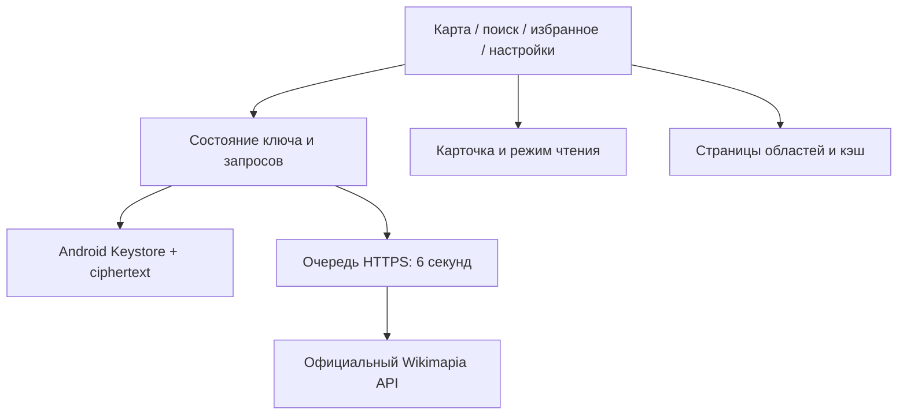

# WikiReader 0.7.3 — Wikimapia для телефона

Неофициальный Android-клиент для чтения объектов Wikimapia без собственного сервера.
Новая тестовая сборка называется **WikiReader Next** и устанавливается рядом с 0.4.

## Что изменилось

- Карточка движется за пальцем при перетаскивании ручки. Короткий жест плавно
  возвращает её, длинный закрывает; развёрнутая карточка сначала сворачивается.
  Возврат в поиск/избранное сохраняет выходящую карточку до конца перехода.

- Плавное открытие/закрытие карточек, выбора объектов и экранов; анимация
  раскрывающихся разделов и подтверждений. Быстрые переключения отменяют старый
  переход. При уменьшении движения в системе переходы выполняются сразу.

- Компактная панель карты: поиск, масштаб, геолокация, обновление и догрузка
  сгруппированы у края. Широкая строка поиска и большая кнопка догрузки заменены
  значками с областью касания 48 × 48 px. Обновлён стартовый экран и Android splash.

- UX/UI: карточка возвращает в исходный список поиска/избранного; поле поиска
  принимает название, ID и ссылку Wikimapia. Удаление места можно отменить,
  удаление API-ключа требует подтверждения. Кнопки карты и основные действия48px,
  текст крупнее; вкладки доступны с клавиатуры.
- [Матрица сценариев и методика UX-аудита](docs/UX-AUDIT-0.7.md).

- «Догрузить область» продолжает загрузку одним нажатием, с прогрессом.
  До 20 дополнительных страниц за раз; движение карты отменяет догрузку.

- Фоновая загрузка не перекрывает карту плашкой: о ней сообщает вращение кнопки
  обновления. Отмена запроса очищает статус; первая загрузка без данных остаётся явной.
- Свежие полностью загруженные области учитываются вместе: их общее покрытие
  позволяет использовать кэш без повторного запроса. Пропуски/неполные страницы
  не принимаются за полную загрузку.
- Обычные объекты рисуются без заливки. Выбранный контур выделен янтарным цветом.
  Если под пальцем несколько объектов, приложение предлагает список, начиная с небольших.
- «Настройки → Кэш областей»: занятый размер, количество, даты, переход на карту,
  срок хранения 1/7/30 дней и закрепление областей от автоматического удаления.
  Закреплённые данные входят в общий лимит 32 области / 12 МиБ. Обычная очистка
  сохраняет их; полное удаление — отдельное подтверждаемое действие.
- Сохраняются шифрование API-ключа, поиск, избранное, даты комментариев, темы,
  автопагинация первых трёх страниц и интервал API не менее 6 секунд.

Свежесть кэша для запроса — 5 минут. Более старые контуры показываются во время
обновления при обращении к области. Подложка OSM, описания и медиа требуют сети.
Ключ остаётся отдельно от кэша, в Android Keystore; в браузере — только в памяти.

## Первый запуск

1. Скачайте [WikiReader-Next-0.7.3.apk](https://github.com/mnevrov/wikimapia-reader/releases/download/v0.7.3/WikiReader-Next-0.7.3.apk) из [GitHub Release v0.7.3](https://github.com/mnevrov/wikimapia-reader/releases/tag/v0.7.3) и установите его. Для приватного репозитория войдите в GitHub под аккаунтом с доступом. Поверх Next 0.5.x–0.7.2 устанавливается обновлением при совпадении подписи; старую 0.4 удалять не требуется.
2. Откройте «Настройки» → вставьте личный ключ → «Сохранить и подключить».
3. Приблизьте карту и остановите движение: загрузятся контуры и следующие страницы. При возвращении к сохранённой области они появятся из кэша.
   Нажмите на объект, чтобы читать описание, фотографии и комментарии.
4. Закройте и повторно запустите приложение: подключение должно восстановиться.
5. «Удалить ключ» удаляет сохранённую запись. Переключение в демо её сохраняет.

Ключ можно получить на [официальной странице Wikimapia](https://wikimapia.org/api?action=create_key)
после авторизации. Не отправляйте его в GitHub или скриншотах.

### Почему приложение устанавливается рядом

В прежних локальных debug-сборках не был сохранён постоянный ключ подписи APK.
Их сертификат нельзя восстановить из APK. Чтобы не удалять работающее приложение
и его данные, debug-версия 0.5 использует `org.example.wikimapreader.next` и имя WikiReader Next.
Ключ и избранное 0.4 не переносятся автоматически: в новой версии введите ключ один раз.
Новый developer keystore сохранён отдельно от git; он нужен для последующих совместимых обновлений Next.

APK из CI подписывается временным debug-ключом runner и **не предназначен для обновления**
переданной сборки. Перед распространением его нужно переподписать сохранённым developer keystore.
Это тестовая сборка, не магазинный релиз.

## Хранение ключа

`CredentialsVaultPlugin`: AES-256-GCM, случайный nonce на запись, проверка целостности,
ключ шифрования в Android Keystore, только ciphertext в приватном SharedPreferences.
Действия выполняются последовательно вне UI thread. Запись исключена из backup/device transfer,
backup приложения отключён; логирование Capacitor и WebView debugging отключены.

Ключ доступен в памяти работающему приложению для запросов и самому Wikimapia через HTTPS.
Удаление приложения удаляет сохранённый ключ. При ошибке восстановления/записи/удаления
показывается сообщение; plaintext fallback в localStorage отсутствует.
Аппаратная защита Keystore зависит от устройства и здесь не заявляется без проверки.

## Сборка и проверки

Требуются Node 22+, Python 3, JDK 21, Android SDK 36 и Build Tools 35.0.0.

```bash
npm ci
npm test
npm run test:probe
npx playwright install chromium
npm run test:browser
npm run android:sync
cd android
./gradlew --no-daemon testDebugUnitTest assembleDebug lintDebug
```

Результат: `android/app/build/outputs/apk/debug/app-debug.apk`. Минимальная версия Android 7.
AndroidKeystore требует проверки на физическом устройстве/эмуляторе. Browser mock native bridge
и JVM-тесты шифрования её не заменяют. [Проверки 0.7.3](docs/CHECKS-0.7.3.md), [проверки 0.7.1](docs/CHECKS-0.7.1.md), [проверки 0.7](docs/CHECKS-0.7.md), [проверки 0.6.1](docs/CHECKS-0.6.1.md), [проверки 0.6](docs/CHECKS-0.6.md).
История: [проверки 0.5.1](docs/CHECKS-0.5.1.md), [проверки 0.5](docs/CHECKS-0.5.md).

## Данные

Используются документированные legacy `box`, `search` и `place.getbyid` через HTTPS.
Область загружается после остановки карты, следующие страницы — вручную. Никакого scraping,
чужого proxy, itiles или обхода ограничений. В 0.3 пользователь подтвердил личный ключ,
реальные контуры и комментарии на телефоне; результаты 0.5 указаны отдельно.

Поиск показывает первые 20 результатов. Ошибка/квота останавливает автозагрузку до ручного
обновления. Полнота покрытия и работоспособность deprecated API не гарантируются.
Подложка OpenStreetMap сохраняет исходные цвета: CARTO требует отдельного ключа.
Фото, карта и реальные данные требуют интернета. Полные описания офлайн не сохраняются.

## Архитектура



`src/main.jsx` — навигация и состояние; `Settings.jsx`, `Details.jsx`, `MapPane.jsx` — экраны;
`useCredentials.js`/`credentials.js` — клиент vault; `CredentialsVaultPlugin.java` — Android-хранилище;
`CredentialCipher.java` — проверяемое JVM-шифрование; `favorites.js` — namespace избранного;
`api.js` — URL/валидация/адаптер; `client.js` — очередь и транспорт.

CI проверяет Node/Python/Chromium, native unit tests, APK и lint. Личные API-ключи в CI не нужны.
[Репозиторий](https://github.com/mnevrov/wikimapia-reader),
[Android workflow](https://github.com/mnevrov/wikimapia-reader/actions/workflows/android.yml),
[исследование источников](docs/DATA-SOURCES.md). Исторические отчёты 0.2–0.4 описывают свои версии.

## Выпуски в GitHub

Публикация APK автоматизирована по тегу версии после однократной настройки
подписи. [Как настроить Secrets и выпускать версии](docs/RELEASING.md).
