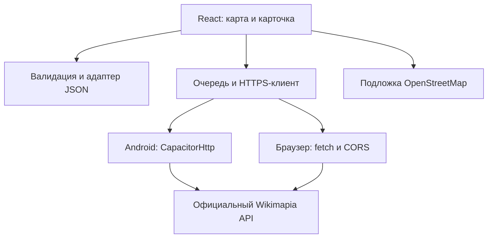

# WikiReader — Android-клиент Wikimapia, 0.2.0

Продолжение `wikimapia-mobile-preflight.zip`. Неофициальный экспериментальный
клиент для чтения описаний объектов на телефоне, без собственного сервера.

**Статус:** экспериментальный MVP собран в Android APK. Подтверждён официальный
HTTPS-путь `box` → `place.getbyid`: область с реальными контурами и описание
объекта из этой области. `box` официально документирован, но deprecated;
современный `place.getbyarea` здесь возвращает `[]`. Пользователь подтвердил запуск и работу APK на телефоне. Полная матрица
Android-сценариев пока не пройдена. [Подтверждённые проверки](docs/RESULTS.md).

## Что работает в интерфейсе

- Карта Leaflet на подложке OpenStreetMap с атрибуцией.
- Явно отмеченный деморежим с вымышленными контурами.
- Раскрывающаяся карточка, прокрутка описания, вкладки фотографий и комментариев.
- Ввод личного ключа только в память; применяется кнопкой, а не каждым символом.
- Получение реального объекта по ID через официальный `place.getbyid`, его контур.
- Ручной запрос области через документированный legacy `box`. Неоднозначный `[]` показан ошибкой.
- Интервал между стартами API-запросов не менее 6 секунд; ожидание видно как загрузка.
- Отмена ожидающих запросов и защита от запоздалых результатов при смене источника.
- Избранные ID сохраняются локально; полные тексты офлайн не сохраняются.

Карта, фото и реальные сведения требуют интернета. Браузерные тесты проверены
с контролируемыми ответами; работа на физическом Android пока не проверена.

## Быстрый запуск

Требуется Node.js 22+ (здесь проверен 24.19.0), npm, Python 3 для диагностик.

```bash
npm ci
npm test
npm run test:probe
npm run build
npm run dev
```

Открыть `http://127.0.0.1:5173`. Для уже собранного `dist` можно без npm:

```bash
python3 -m http.server 5173 --bind 127.0.0.1 --directory dist
```

Не открывайте `dist/index.html` через `file://`: модульные скрипты требуют HTTP.

## Ключ и реальные данные

1. Для постоянного использования самостоятельно авторизуйтесь на [Wikimapia](https://wikimapia.org/api?action=my_keys)
   и создайте свой ключ. Доступность выдачи новых ключей здесь не подтверждена.
Для краткой проверки можно использовать публичный `example`, опубликованный в
официальной документации. У него общий лимит; это не личный ключ и не гарантия
долгосрочной работы.

2. В приложении откройте «Настройки», введите ключ в скрытое поле и нажмите
   «Применить ключ». Не отправляйте ключ в чат, GitHub или скриншотах.
3. В поле ID укажите число из ссылки Wikimapia, например `55`, и нажмите
   «Открыть по ID». Страница вида `https://wikimapia.org/55/...` имеет ID `55`.
4. Для проверки слоя приблизьте карту до 16+ и нажмите «Загрузить область».
   В MVP отображается первая страница до 50 объектов, если API её вернёт;
   автоматическая пагинация и полнота покрытия пока не реализованы.
5. «Включить демо» очищает ключ из состояния. Перезапуск процесса тоже его теряет.

Wikimapia требует ключ в query-параметре HTTPS-запроса. Он доступен самому
Wikimapia и сетевому отладчику владельца устройства. Ключ не встраивается в APK,
не сохраняется в localStorage/файл и не включается в диагностический отчёт.
В Android-конфигурации отключены логи Capacitor и WebView debugging, HTTP
и backup приложения. Уже начавшийся нативный запрос нельзя прервать через
AbortSignal: ответ игнорируется после переключения; ожидающий запрос отменяется.

## Диагностика без передачи личного ключа

Самый безопасный способ — выполнить пробник у себя с локальным скрытым вводом:

```bash
python3 scripts/probe.py --ask-key --out probe-personal.json
```

Либо публичный пример из документации, без личных credentials:

```bash
python3 scripts/probe.py --example --out probe-example.json
```

Коды завершения: `0` — подтверждены объекты области с геометрией и деталь;
`1` — хотя бы один критерий не подтверждён; `2` — ключ не задан.
Пробник не делает обходов и автоматических повторов; между API-запросами ждёт
6 секунд. Ошибка локального DNS не отменяет HTTPS-проверку, если штатный proxy
среды может разрешить имя сам. В отчёте сохраняются типы ошибок, не URL с ключом.
Для дальнейшей работы достаточно передать `probe-personal.json`, а не ключ.

## Android: сборка и установка

Нативный проект уже создан в `android/`, повторный `cap add` не требуется.
Нужны JDK 21, Android SDK Platform 36, Build-Tools 35.0.0 (выбирает AGP),
Platform-Tools и доступ к Google Maven/Maven Central/Gradle.

```bash
export JAVA_HOME=/path/to/jdk-21
export ANDROID_HOME=/path/to/Android/Sdk
npm ci
npm run android:build
```

Результат: `android/app/build/outputs/apk/debug/app-debug.apk`.
Требуется Android 7.0+ (API 24). Это debug APK для личной проверки,
не подписанный release для публикации в магазине.

Через USB с включённой отладкой:

```bash
adb install -r android/app/build/outputs/apk/debug/app-debug.apk
```

Или откройте APK на телефоне и разрешите установку для приложения, которым
открываете файл. При конфликте подписи с собственной предыдущей сборкой
удалите предыдущую версию (избранное будет удалено).

После установки проверить вручную: демоконтур → карточка → развернуть → вкладки
→ закрыть; затем личный ключ → ID → описание → реальный контур → область.
Проверить кнопку Android «Назад», поворот экрана, клавиатуру и системные отступы.
Эти проверки не выдаются за выполненные без реального устройства.

## Тесты

```bash
npm test
npm run test:probe
npx playwright install chromium
npm run test:browser
cd android
./gradlew lintDebug
```

В `tests/fixtures/place-55.projection.json` сокращённая проекция реального
ответа №55, полученного 18.10.2026 по Москве с публичным `example`: ID,
заголовок, короткий фрагмент описания, геометрия, URL одного фото. Комментарии,
IP и имена пользователей исключены. В `box-moscow.projection.json` — реальные
пять объектов и их контуры из ответа `box` (без пользовательских комментариев). Остальные тестовые API-ответы синтетические.

## Архитектура



`src/api.js` — URL, валидация и преобразование; `src/client.js` — транспорт,
таймауты и интервал; `src/main.jsx` — интерфейс и актуальность ответов;
`scripts/probe.py` — независимая диагностика сети и пригодности данных.

Исследование альтернатив и исходники Nakarte: [docs/DATA-SOURCES.md](docs/DATA-SOURCES.md).
Приложение не использует чужой proxy, scraping, itiles, чужие ключи или HTTP fallback.
Перед распространением и коммерческим использованием отдельно уточните условия
Wikimapia, лицензии данных/фото и политику выбранной картографической подложки.
