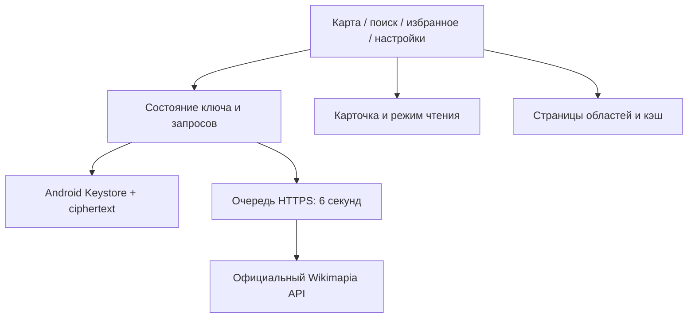

# WikiReader 0.5 — Wikimapia для телефона

Неофициальный Android-клиент для чтения объектов Wikimapia без собственного сервера.
Новая тестовая сборка называется **WikiReader Next** и устанавливается рядом с 0.4.

## Что изменилось

- API-ключ вводится один раз: Android шифрует его и восстанавливает при запуске.
  В настройках можно заменить или удалить ключ. В браузере ключ остаётся только в памяти.
- Нижняя навигация разделяет карту, поиск, избранное и настройки.
- На карте — строка поиска, геолокация, обновление и компактная сводка области.
- Карточка раскрывается для чтения, вкладки фото/комментариев сразу открывают большой режим.
  Комментарии содержат даты API; избранное хранит названия, отдельно для demo/реальных объектов.
- Сохраняются автозагрузка с отменой устаревших запросов, следующие страницы по кнопке «Ещё 50»,
  общий интервал запросов не менее 6 секунд и чёрная/светлая/системная тема.

## Первый запуск

1. Установите **переданный WikiReader-Next-0.5.0.apk**. Старую 0.4 удалять не требуется.
2. Откройте «Настройки» → вставьте личный ключ → «Сохранить и подключить».
3. Приблизьте карту и остановите движение: загрузятся контуры первой страницы.
   Нажмите на объект, чтобы читать описание, фотографии и комментарии.
4. Закройте и повторно запустите приложение: подключение должно восстановиться.
5. «Удалить ключ» удаляет сохранённую запись. Переключение в демо её сохраняет.

Ключ можно получить на [официальной странице Wikimapia](https://wikimapia.org/api?action=create_key)
после авторизации. Не отправляйте его в GitHub или скриншотах.

### Почему приложение устанавливается рядом

В прежних локальных debug-сборках не был сохранён постоянный ключ подписи APK.
Их сертификат нельзя восстановить из APK. Чтобы не удалять работающее приложение
и его данные, debug-версия 0.5 использует `org.example.wikimapreader.next` и имя WikiReader Next.
Ключ и избранное 0.4 не переносятся автоматически: в новой версии введите ключ один раз.
Новый developer keystore сохранён отдельно от git; он нужен для последующих совместимых обновлений Next.

APK из CI подписывается временным debug-ключом runner и **не предназначен для обновления**
переданной сборки. Перед распространением его нужно переподписать сохранённым developer keystore.
Это тестовая сборка, не магазинный релиз.

## Хранение ключа

`CredentialsVaultPlugin`: AES-256-GCM, случайный nonce на запись, проверка целостности,
ключ шифрования в Android Keystore, только ciphertext в приватном SharedPreferences.
Действия выполняются последовательно вне UI thread. Запись исключена из backup/device transfer,
backup приложения отключён; логирование Capacitor и WebView debugging отключены.

Ключ доступен в памяти работающему приложению для запросов и самому Wikimapia через HTTPS.
Удаление приложения удаляет сохранённый ключ. При ошибке восстановления/записи/удаления
показывается сообщение; plaintext fallback в localStorage отсутствует.
Аппаратная защита Keystore зависит от устройства и здесь не заявляется без проверки.

## Сборка и проверки

Требуются Node 22+, Python 3, JDK 21, Android SDK 36 и Build Tools 35.0.0.

```bash
npm ci
npm test
npm run test:probe
npx playwright install chromium
npm run test:browser
npm run android:sync
cd android
./gradlew --no-daemon testDebugUnitTest assembleDebug lintDebug
```

Результат: `android/app/build/outputs/apk/debug/app-debug.apk`. Минимальная версия Android 7.
AndroidKeystore требует проверки на физическом устройстве/эмуляторе. Browser mock native bridge
и JVM-тесты шифрования её не заменяют. [Подтверждённые результаты 0.5](docs/CHECKS-0.5.md).

## Данные

Используются документированные legacy `box`, `search` и `place.getbyid` через HTTPS.
Область загружается после остановки карты, следующие страницы — вручную. Никакого scraping,
чужого proxy, itiles или обхода ограничений. В 0.3 пользователь подтвердил личный ключ,
реальные контуры и комментарии на телефоне; результаты 0.5 указаны отдельно.

Поиск показывает первые 20 результатов. Ошибка/квота останавливает автозагрузку до ручного
обновления. Полнота покрытия и работоспособность deprecated API не гарантируются.
Подложка OpenStreetMap сохраняет исходные цвета: CARTO требует отдельного ключа.
Фото, карта и реальные данные требуют интернета. Полные описания офлайн не сохраняются.

## Архитектура



`src/main.jsx` — навигация и состояние; `Settings.jsx`, `Details.jsx`, `MapPane.jsx` — экраны;
`useCredentials.js`/`credentials.js` — клиент vault; `CredentialsVaultPlugin.java` — Android-хранилище;
`CredentialCipher.java` — проверяемое JVM-шифрование; `favorites.js` — namespace избранного;
`api.js` — URL/валидация/адаптер; `client.js` — очередь и транспорт.

CI проверяет Node/Python/Chromium, native unit tests, APK и lint. Личные API-ключи в CI не нужны.
[Репозиторий](https://github.com/mnevrov/wikimapia-reader),
[Android workflow](https://github.com/mnevrov/wikimapia-reader/actions/workflows/android.yml),
[исследование источников](docs/DATA-SOURCES.md). Исторические отчёты 0.2–0.4 описывают свои версии.
