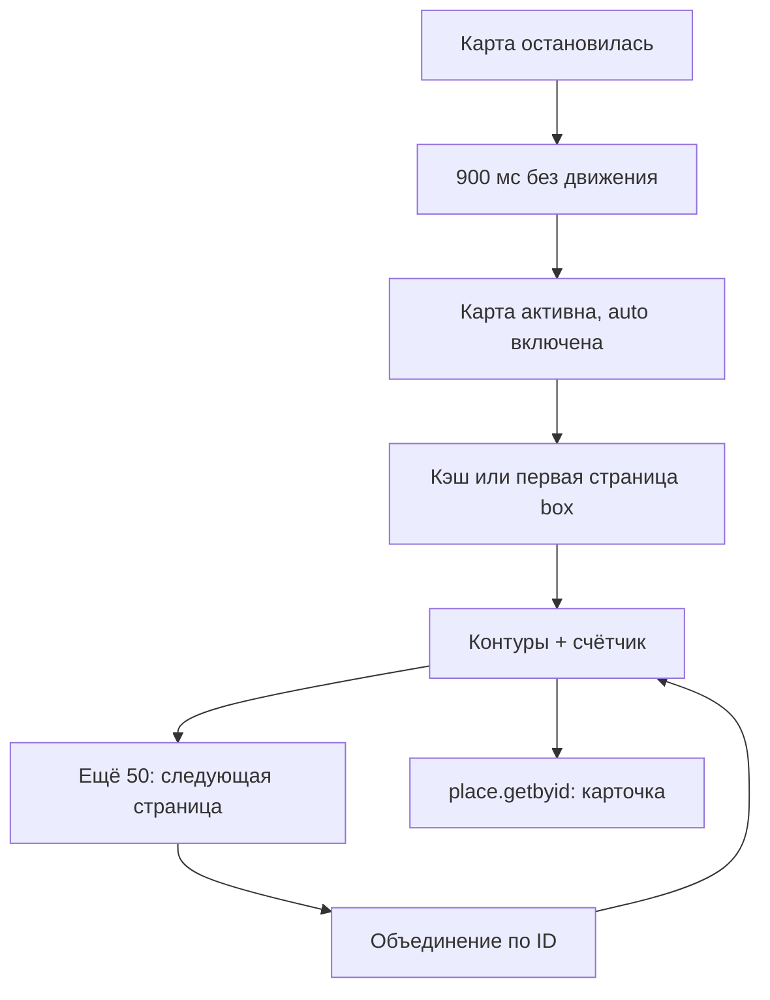

# Проверки WikiReader 0.4.0

Дата: 18 октября 2026, Москва.

## Что изменилось

Компактная шапка и нижняя панель действий освобождают место карте. Карточка
получила больше места для чтения, меньшие промежутки, дату рядом с автором,
доступные кнопки и видимую атрибуцию OSM даже в раскрытом состоянии.

Автозагрузка первой страницы запускается через 900 мс после остановки карты.
Она не работает при открытых настройках/карточке или в фоне. В настройках
можно перейти к ручной загрузке. Между всеми стартами запросов минимум 6 секунд.
Следующие страницы запрашиваются явно кнопкой «Ещё 50», объединяются по ID.
Перемещение отключает кнопку старой области. Кэш содержит максимум восемь
областей в памяти текущего ключа; ручная загрузка обходит кэш. При ошибке
автоматические запросы останавливаются до ручной загрузки.

Android Back закрывает настройки, затем карточку, затем сворачивает приложение.
Геолокация вызывается один раз по нажатию, без watchPosition и фонового доступа.
Ключ по-прежнему не сохраняется; сохраняются только тема, автозагрузка, карта
и избранные ID.

## Подтверждённые результаты

| Проверка | Результат | Что она доказывает |
|---|---|---|
| Node `npm test` | PASS, 27 тестов | URL/JSON, страницы, дубликаты, отмена, кэш, даты, поиск, тайминг клиента, темы |
| Python `npm run test:probe` | PASS, 3 теста | Критерии готовности диагностического скрипта |
| Chromium Playwright | PASS, 15 сценариев | Мобильные карточки/темы, автозагрузка, фон, следующие страницы, поиск, разрешение/отказ геолокации, размеры 320×640, 844×390, 768×1024 |
| Native clean assembleDebug + lintDebug | PASS, exit 0 | Собран Android APK с двумя официальными плагинами; lint завершён |
| Независимое read-only ревью | Повторная проверка без открытых P1/P2 | Три найденные проблемы исправлены, описание ниже |
| Физический Android 0.4 | НЕ ПРОВЕРЕН | Требуется установка пользователем |

Браузерные запросы API, фото и тайлов заменены контролируемыми ответами.
Браузерная геолокация не доказывает работу системного диалога Android.
Скриншоты пользователя подтвердили личный ключ, реальные контуры и комментарии
в 0.3, а не новые сценарии 0.4.

## Реальный поиск и даты

Через HTTPS проверен документированный legacy `search`, публичный ключ
`example`, q=Eiffel, lat=48.858, lon=2.294, count=20: HTTP 200, folder с 20
результатами, found=111; первым вернулся ID 55 «Эйфелева башня».
Машиночитаемый снимок: [search-check.json](search-check.json). В пробе
`place.search` вернулся debug-ответ, поэтому интерфейс использует `search`.
Метод deprecated и его дальнейшая доступность не гарантируется.

Поле комментария date=1163698281 зафиксировано в прежнем реальном ответе API.
Это Unix seconds: 2006-11-16T17:31:21.000Z. Дата отображается по-русски
в часовом поясе устройства; отсутствующие/невалидные даты не показываются.
Тест использует синтетический текст комментария, не IP/содержимое пользователя.

## Независимое ревью

Ревьюер только читал код и исходники установленных официальных Android-плагинов;
сборки/тесты одновременно с основной проверкой не запускал.

1. После ошибки stop() повторно сообщал старую ошибку и блокировал auto даже
   после успешной ручной загрузки. Исправлено; добавлен регрессионный тест.
2. После движения кнопка «Ещё» могла запрашивать прежнюю область. Добавлен
   invalidate(), отключающий пагинацию; unit и браузерная проверка.
3. Раскрытая карточка перекрывала OSM attribution. В карточку добавлена
   собственная постоянная атрибуция, видимая также при загрузке/ошибке.

В ходе браузерной проверки также исправлено очищение демонстрационных контуров
при остановке неактивного загрузчика. Предварительные падающие прогоны не
считаются успешными; приведены результаты повторного прогона.

## Тёмная карта

Обычная OSM сохранена. На [актуальной странице CARTO](https://carto.com/basemaps/index.html)
для Dark Matter требуется отдельный ключ. Без него новый источник не подключён.
Старые общедоступные CDN URL не используются в обход требования.

## Проверка на телефоне

1. Установить 0.4 поверх локальной 0.3. Ввести ключ в приложении.
2. Закрыть настройки, переместить и остановить карту масштаба 16+. Убедиться,
   что контуры загружаются; быстро переместиться в другую область и проверить
   соответствие последнему положению.
3. В плотной области нажать «Ещё 50», проверить рост счётчика без повторов.
4. Открыть объект, вкладку комментариев: даты только у комментариев с date.
   Развернуть карточку, повернуть телефон, проверить прокрутку и атрибуцию.
5. Проверить Back: настройки → карточка → сворачивание; вернуться в приложение.
6. Проверить ⌖ с разрешением, отказом и выключенной геопозицией. Постоянного
   слежения нет. Проверить поиск по названию и переход в результат.
7. Отключить автозагрузку, переместить карту: до ручной кнопки запросов нет.
8. Уйти в фон при загрузке: поздние данные не должны менять текущую карточку.

Ограничения: не офлайн-клиент, нет гарантии полного покрытия API; поиск
показывает первые 20 результатов. Ключ повторно вводится после перезапуска
процесса. Новая версия не содержит встроенного личного ключа.

## Проверяемая цепочка данных

Любой новый запрос проходит общий интервал 6 секунд. Движение, фон или смена
ключа отменяют ожидающий запрос; старый ответ не применяется к новой области.
Поиск выполняется только отправкой формы и использует ту же очередь.

## APK

- Версия 0.4.0, versionCode 4, org.example.wikimapreader, Android 7.0+.
- Размер 4 965 790 байт. SHA256: `0a4b0aa42471de50d9508ba3800070a03f7c6c27b441a3d1e805da02822d2991`.
- Подпись apksigner проверена, сертификат совпадает с переданной локальной 0.3.
- Все web-ресурсы в APK побайтно совпали с проверенным dist.
- В native registry присутствуют AppPlugin и GeolocationPlugin, loggingBehavior=none, стартовый фон чёрный.
- Это debug APK для личной проверки. APK из CI может иметь другой debug-сертификат.
- Установка: открыть APK на телефоне и подтвердить обновление; удалять 0.3 не нужно. После перезапуска ключ требуется ввести снова.

Машиночитаемая проверка: [apk-0.4.json](apk-0.4.json).
