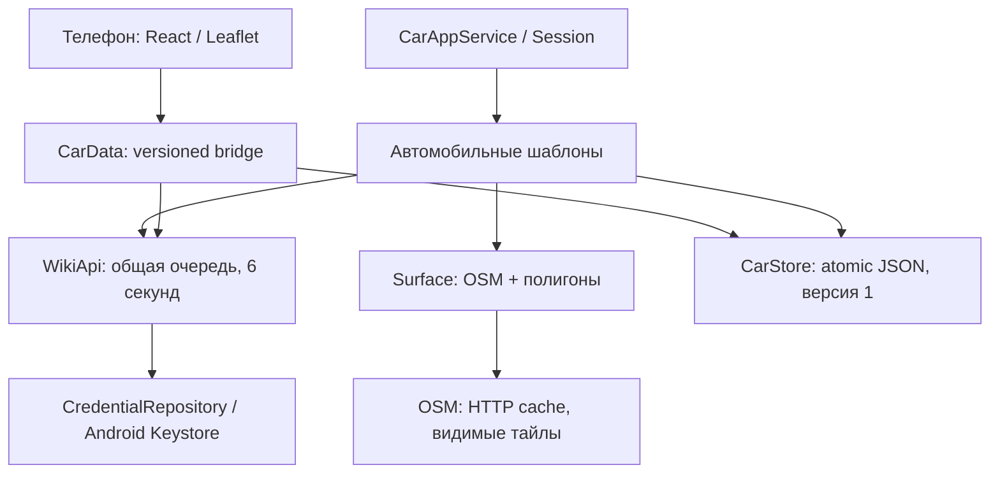

# WikiReader в Android Auto

Это отдельная экспериментальная **projected Android Auto** сборка. Основная версия
Next 0.7.3 остаётся отдельным приложением. Ветка `feat/android-auto` не должна
сливаться в main без разрешения владельца.

## Установка

В PR откройте проверку Android APK → Summary → Artifacts → **WikiReader-AutoDev-…**.
Распакуйте архив и установите `WikiReader-AutoDev-0.7.3-debug.apk` на телефон.
Для приватного репозитория нужен вход в GitHub. Проверяйте SHA256SUMS.txt.

| APK | Package в debug | Назначение |
| --- | --- | --- |
| AutoDev | `org.example.wikimapreader.autodev.next` | Отдельная тестовая установка, свои данные и Android Keystore |
| mobile | `org.example.wikimapreader.next` | Регрессионная сборка без CarAppService |

**Не устанавливайте CI mobile поверх рабочей Next:** временная debug-подпись
runner не совпадает с постоянной подписью релиза. Используйте отдельный эмулятор
или тестовый телефон для mobile. Для AutoDev удалять Next не нужно. CI debug-ключ
может измениться между запусками; для последовательных AutoDev обновлений используйте
локальную сборку с одним debug keystore, иначе сохраните нужные данные перед удалением.

1. Откройте **WikiReader Auto Dev** на телефоне.
2. В настройках сохраните личный Wikimapia API key. Его можно получить на
   https://wikimapia.org/api/ ; ключ основной Next автоматически не переносится.
3. Разрешите геолокацию. При её отсутствии используется последняя карта, затем Москва.
4. Подключите телефон к Android Auto. Выберите WikiReader Auto Dev в списке приложений.
5. Если приложения нет: проверьте канал установки и поддержку templated POI у host.

Обычный sideload **не гарантирует** обнаружение POI-приложения на физическом Auto.
Developer mode/Unknown sources не является универсальным способом установки для
всех категорий и версий host. Надёжный путь разработки — DHU; на реальном устройстве
используйте разрешённый Google Play internal testing/internal app sharing канал
с выполнением требований аккаунта, подписи и допуска категории. Публикация/одобрение
Google Play в этой ветке не выполняется. PF-1 и пригодность содержания для водителя
требуют отдельной проверки Google; одобрение не обещается.

## Что есть в автомобиле

При Car App API ≥7 — собственная карта OSM, контуры без заливки, выделенный объект,
GPS, следование, масштаб и pan. Ручное перемещение отключает следование; кнопка
«К автомобилю» возвращает его. Нажатие на пересечение предлагает выбор объектов.
На API <7 — штатная карта host с POI-маркерами и списком, **без полигонов**.

Поиск принимает название, положительный ID и ссылку wikimapia.org. Ввод предоставляет
host; приложение не обходит ограничения водителя. Избранное хранится совместно
между телефоном и Auto **внутри AutoDev**. Карточка содержит только короткий текст;
полные описания, фото и комментарии остаются на телефоне. «Маршрут» использует
`CarContext.ACTION_NAVIGATE` с `geo:lat,lon`: нужен совместимый установленный навигатор.
«Открыть на телефоне» доступно при парковке; ID сохраняется, поэтому при ограничении
фонового запуска можно самостоятельно открыть AutoDev и получить нужную карточку.

«Ещё» загружает следующую страницу. API ограничен 6 секундами между запросами,
bbox ≤0.035°; на высокой скорости и в плотном городе загрузка всех объектов не
гарантируется. Частичное покрытие не означает отсутствие других объектов.

## Архитектура



Car-классы, manifest и AndroidX зависимости находятся только в `autoDev` source set.
`mobile` сохраняет исходные React-экраны. Минимальная интеграция: conditional native
bridge, общее чтение ciphertext ключа, обработка pending ID при открытии телефона.
Alias `wikireader.api-key.v1`, файл `credentials-v1`, поле `record` и AES-GCM/AAD
сохранены. URL с ключом не возвращается из bridge, ошибки сервера не выводятся сырыми.

Native состояние — app-private AtomicFile, 12 MiB/32 области. Сохраняются публичные
контуры, заголовки и признаки полноты; описания и медиа в offline-кэш не входят.
По умолчанию TTL 1 день, в настройках 7/30 дней; закреплённые контуры удерживаются
в пределах лимита. Ключ не сохраняется в кэше. Подложка кэшируется по HTTP заголовкам,
без фонового prefetch или offline-download OSM. Видимые тайлы имеют User-Agent,
на карте присутствует © OpenStreetMap contributors. Без сети подложка может быть
неполной; сохранённые контуры продолжают отображаться с предупреждением о давности.

Миграция избранного импортирует старый localStorage один раз и разделяет demo/live.
Последующие изменения — явные add/remove операции с локальным журналом до native
acknowledgement. Web cache импортируется один раз; после этого native adapter
обслуживает телефон и car. Старые localStorage/IndexedDB не удаляются как резерв
восстановления. Первый запуск сразу в Auto не может прочитать старый IndexedDB до
первого открытия WebView; это ограничение платформы. AutoDev не имеет доступа к
данным отдельно установленной Next.

## Сборка и проверки

```bash
npm ci
npm test
npm run test:probe
npx playwright install --with-deps chromium
npm run test:browser
npm run android:sync
cd android
./gradlew testMobileDebugUnitTest testAutoDevDebugUnitTest \
  lintMobileDebug lintAutoDevDebug assembleMobileDebug assembleAutoDevDebug
cd ..
python3 scripts/check-auto-apks.py
```

Требуются JDK 21, Android SDK 36, build-tools 35.0.0. CI сохраняет оба APK,
SHA256, packaged manifest isolation checks и отчёты. Ветка не выпускает новую
стабильную версию Next и не запускает release-тег. Скрипт стабильного релиза
перенастроен на `mobileDebug`; прежний keystore не меняется.

AndroidX 1.8.0-rc01 выбран из-за security fix и прямой рекомендации Google от
26.08.2026. Это RC, не stable; 1.7.0 стабильна, но не содержит этого исправления.
Переход на stable с исправлением — отдельное обновление после её появления.

## DHU

```bash
sdkmanager 'extras;google;auto'
adb devices
adb forward tcp:5277 tcp:5277
# На телефоне: Android Auto → developer settings → Start head unit server
$ANDROID_SDK_ROOT/extras/google/auto/desktop-head-unit
```

Сценарии ручной приёмки: cold start и reconnect; GPS/отказ разрешения; follow/pan/
zoom; API 1–6 и ≥7; пересечения; поиск/избранное/маршрут/телефон; offline/429;
portrait/wide, день/ночь; пересоздание surface; перезапуск процесса; отдельная Next.
Для live-контуров используйте свой ключ локально, не в CI. Сохраняйте снимки DHU
и результаты только после фактического выполнения. JVM/app-testing не заменяет DHU.

## Безопасное объединение после разрешения

1. Проверить оба APK на устройстве, выполнить матрицу DHU и live API.
2. Проверить допуск POI/канала Google Play и стабильную версию AndroidX с security fix.
3. В отдельном PR включить car source set в стабильный flavor; сохранить appId,
   alias, данные, release versionCode и постоянный сертификат Next.
4. Проверить обновление с 0.7.3 и миграции на копии данных; сохранить rollback.
5. Только после разрешения слить и выпустить подписанный GitHub Release через Actions.

Источники: [POI](https://developer.android.com/training/cars/apps/poi),
[Surface](https://developer.android.com/training/cars/apps/library/draw-maps),
[взаимодействие с картой](https://developer.android.com/training/cars/apps/library/interact-map),
[AndroidX releases](https://developer.android.com/jetpack/androidx/releases/car-app),
[DHU](https://developer.android.com/training/cars/testing/dhu),
[OSM tiles policy](https://operations.osmfoundation.org/policies/tiles/).

Полный [отчёт проверок и ограничений](CHECKS.md) различает автоматическую проверку
и невыполненные испытания на устройстве. При движении новые viewport объединяются,
ожидающий 6-секундный слот запрос не отменяется каждым GPS update. Ошибка/квота
останавливает автоматические повторения до явного обновления. API-запросы исключены
из HTTP disk cache, используемого для OSM.
